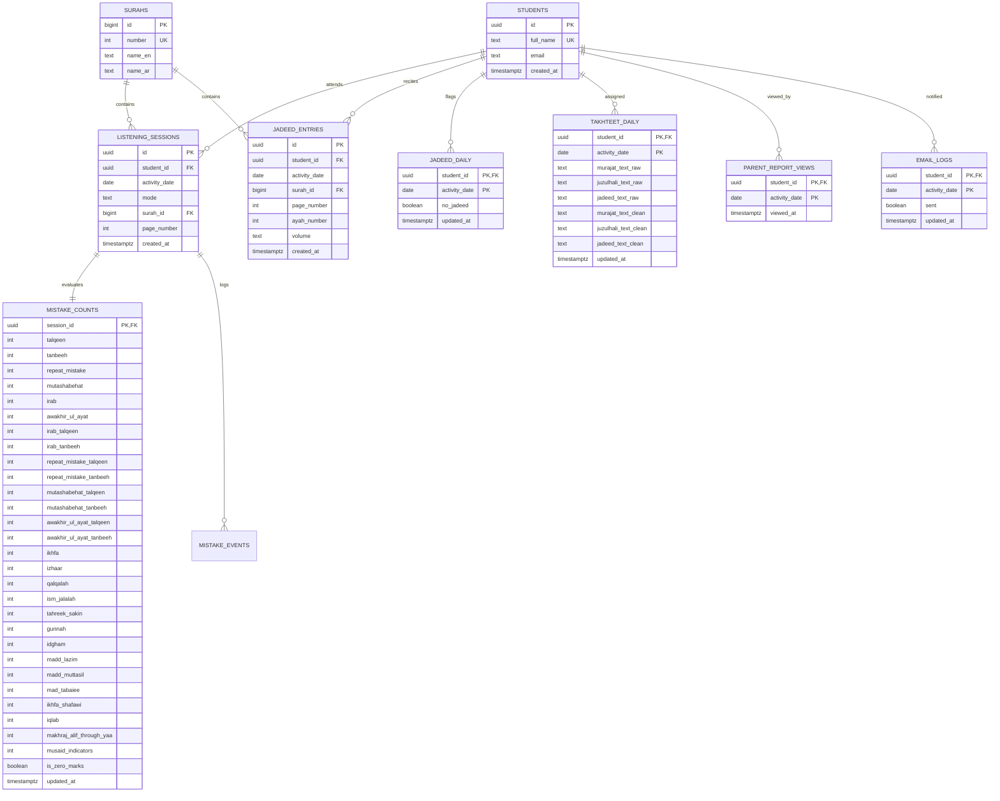

# Project M — Al Madrasa-tus-Saifiyah-tul-Burhaniyah (Mukhayyam Portal)
> **Comprehensive Technical Architecture, Domain Model, Codebase Reference, and AI Agent Onboarding Guide**

---

## 📑 Table of Contents
1. [Executive Overview & System Purpose](#1-executive-overview--system-purpose)
2. [High-Level Architecture & Tech Stack](#2-high-level-architecture--tech-stack)
3. [Repository Directory & File Breakdown](#3-repository-directory--file-breakdown)
4. [Quran Recitation Domain Model & Pedagogical Rules](#4-quran-recitation-domain-model--pedagogical-rules)
5. [Database Schema & PostgREST Data Layer](#5-database-schema--postgrest-data-layer)
6. [Scoring, Mistakes, Makharij & Ahkam Engine](#6-scoring-mistakes-makharij--ahkam-engine)
7. [Authentication, RBAC & HMAC Session Security](#7-authentication-rbac--hmac-session-security)
8. [Module-by-Module Code Reference](#8-module-by-module-code-reference)
   - [8.1 Application Core (`streamlit_app.py`, `config.py`)](#81-application-core-streamlit_apppy-configpy)
   - [8.2 Database Access Layer (`app/db.py`)](#82-database-access-layer-appdbpy)
   - [8.3 UI System & Islamic Design Tokens (`app/ui/style.py`, `shared.py`)](#83-ui-system--islamic-design-tokens-appuistylepy-sharedpy)
   - [8.4 Recitation Modules (`murajat.py`, `juzulhali.py`, `jadeed.py`, `takhteet.py`)](#84-recitation-modules-murajatpy-juzulhalipy-jadeedpy-takhteetpy)
   - [8.5 Lesson Planner Engine (`planner.py`)](#85-lesson-planner-engine-plannerpy)
   - [8.6 Reporting & Analytics Engine (`report.py`, `report_pdf.py`, `analytics.py`, `parent_report.py`)](#86-reporting--analytics-engine-reportpy-report_pdfpy-analyticspy-parent_reportpy)
   - [8.7 Email Notification Engine (`email_page.py`, `email_utils.py`)](#87-email-notification-engine-email_pagepy-email_utilspy)
9. [Configuration, Secrets & Setup Guide](#9-configuration-secrets--setup-guide)
10. [End-to-End Testing & Verification](#10-end-to-end-testing--verification)
11. [Data Export & Backup Utility](#11-data-export--backup-utility)
12. [AI Model Prompting & Modification Guidelines](#12-ai-model-prompting--modification-guidelines)

---

## 1. Executive Overview & System Purpose

**Project M** is a specialized, production-grade web application created for **Al Madrasa-tus-Saifiyah-tul-Burhaniyah** to manage, track, assess, and report on Quranic recitation and memorization (Hifz) workflows. 

The software serves three primary user personas:
1. **Muhaffiz / Teacher / Admin**: Records live student recitations, tracks multi-layered pronunciation/memorization mistakes with instant auditory-visual feedback, manages daily homework (Takhteet), schedules monthly lesson plans, and generates official institutional reports.
2. **Student & Parents**: Access a dedicated Parent Progress Portal displaying daily target vs. actual recitation achievements, historical comparison trends, absence notices, and visual mistake analytics.
3. **Institutional Administration**: Aggregates class-wide attendance, monthly grade averages (GPA), cumulative One-Page Reports (OPR), Ummul Banin memorization progress sheets, and automated email broadcasts.

---

## 2. High-Level Architecture & Tech Stack

```
                                  +---------------------------------------+
                                  |         Client Web Browser            |
                                  | (Desktop, Tablet, Mobile Landscape)   |
                                  +-------------------+-------------------+
                                                      |
                                    HTTP / WebSocket (Port 8501)
                                                      |
                                                      v
                                  +---------------------------------------+
                                  |          Streamlit Frontend           |
                                  |   (Python 3.10+ / Custom CSS / JS)    |
                                  +-------------------+-------------------+
                                                      |
                          +---------------------------+---------------------------+
                          |                           |                           |
                          v                           v                           v
              +-----------------------+   +-----------------------+   +-----------------------+
              |   Direct PostgREST    |   | SMTP Email Dispatcher |   |  Headless Playwright  |
              |     HTTP Client       |   | (smtplib / SSL 465)   |   |   (Chromium Engine)   |
              |     (`app/db.py`)     |   | (`app/email_utils.py`)|   |  (`app/report_pdf.py`)|
              +-----------+-----------+   +-----------+-----------+   +-----------+-----------+
                          |                           |                           |
                          v                           v                           v
              +-----------------------+   +-----------------------+   +-----------------------+
              |  Supabase PostgreSQL  |   | Parent / Student Inbox|   | High-Res Vector PDFs  |
              |  Database & Storage   |   +-----------------------+   +-----------------------+
              +-----------------------+
```

### Core Technologies
- **Frontend / Application Framework**: [Streamlit](https://streamlit.io/) (v1.58.0+) with non-blocking threaded background operations, session state caching, and iframe DOM bridge.
- **Database Layer**: [Supabase](https://supabase.com/) PostgreSQL exposed via PostgREST HTTP JSON endpoints (`requests`-based custom `SupabaseRest` wrapper without heavy SDK dependencies).
- **Styling & Aesthetics**: Custom Islamic Manuscript theme (Deep Emerald `#0E6B50`, Antique Gold `#D4AF37`, Cream `#FBF6EA`, Dark Charcoal `#1E1A12`), RTL typography with Google Fonts (*Amiri*, *Noto Naskh Arabic*).
- **Client-Side Automation**: JavaScript embedded via hidden iframe handling Web Audio API tone synthesis, Wake Lock API (prevents device screen dimming during recitation), auto-blur keyboard management for mobile, and orientation lock to landscape.
- **Reporting & Visuals**: [Altair](https://altair-viz.github.io/) / Vega-Lite charts, responsive HTML5 print-ready templates, and Playwright for pixel-perfect PDF rendering.
- **Security**: HMAC SHA-256 session signatures verifying URL state against server secrets to eliminate query parameter spoofing.
- **E2E Testing**: Selenium WebDriver test harness with Chromium.

---

## 3. Repository Directory & File Breakdown

```
Project_M/
├── .streamlit/
│   └── secrets.toml                 # Environment secrets (Supabase credentials, SMTP, Auth)
├── app/
│   ├── __init__.py                  # Package initializer
│   ├── config.py                    # Settings dataclass & secret loader
│   ├── db.py                        # PostgREST REST client, background DB workers, queries
│   ├── email_utils.py               # MIME HTML email generators & background SMTP dispatcher
│   ├── quran_metadata.json          # Complete 604-page Madani Mushaf Surah-Page-Ayah structure
│   ├── report_pdf.py                # HTML report templates, Playwright PDF export engine
│   └── ui/
│       ├── __init__.py              # Package initializer
│       ├── analytics.py             # Altair interactive charts, GPA & mistake analytics
│       ├── email_page.py            # Teacher email dispatch UI & live iframe previews
│       ├── home.py                  # Default routing fallback
│       ├── jadeed.py                # Jadeed new lesson entry interface
│       ├── juzulhali.py             # Juzulhali (current juz) recitation tester
│       ├── login.py                 # Multi-role authentication (Admin vs Parent)
│       ├── murajat.py               # Murajat (revision) recitation tester
│       ├── parent_report.py         # Dedicated parent portal (Target vs Actual comparison)
│       ├── planner.py               # Takhteet lesson scheduler & automated monthly calendar
│       ├── report.py                # Centralized 11-category reporting dashboard
│       ├── shared.py                # Common widgets, mistake counter pads, Web Audio, HMAC
│       ├── student.py               # Student selector dropdown & new student modal
│       ├── style.py                 # Islamic theme CSS stylesheet & UI reset hooks
│       └── takhteet.py              # Daily homework entry (Murajat, Juzulhali, Jadeed)
├── supabase/
│   ├── schema.sql                   # Base DDL: Tables, constraints, seed surahs, RLS
│   ├── add_student_email.sql        # Migration: student email column
│   ├── migration_add_ahkam.sql      # Migration: Tajweed Ahkam columns
│   ├── migration_add_awakhir.sql    # Migration: Awakhir ul Ayat mistake columns
│   ├── migration_add_email_logs.sql # Migration: email dispatch logging table
│   ├── migration_add_ikhfa_shafawi_iqlab.sql # Migration: expanded Tajweed rules
│   ├── migration_add_irab_and_volume.sql     # Migration: grammar mistakes & volume levels
│   ├── migration_add_is_zero_marks.sql       # Migration: zero-marks override flag
│   ├── migration_add_makharij.sql            # Migration: 28 Arabic letter articulation points
│   ├── migration_add_musaid_analysis.sql     # Migration: assistance indicator columns
│   ├── migration_add_students.sql            # Migration: seed student roster
│   ├── migration_change_listening_session_constraints.sql # Migration: loosened schema constraints
│   └── migration_parent_report_views.sql     # Migration: parent view tracker table
├── tests/
│   ├── e2e_utils.py                 # Headless Streamlit runner & port health-check utilities
│   └── test_e2e_streamlit.py        # Selenium test suite for all major user journeys
├── export_data.py                   # Automated CSV backup utility for all database tables
├── requirements.txt                 # Frozen Python dependencies
├── run_e2e_tests.py                 # CLI launcher for end-to-end Selenium suite
└── streamlit_app.py                 # Root application entry point & JS iframe manager
```

---

## 4. Quran Recitation Domain Model & Pedagogical Rules

### 4.1 The Three Core Recitation Streams
1. **Murajat (مراجعة — Revision)**:
   - Recitation of previously memorized Surahs/Ajzaa across the entire Quran.
   - Tested by selecting a specific Surah and page number.
2. **Juzulhali (الجزء الحالي — Current Juz Revision)**:
   - Revision specifically focused on the student's current active 20-page Juz.
   - Tested by selecting a Surah and specific page.
3. **Jadeed (جديد — New Daily Lesson)**:
   - Daily newly memorized portion.
   - Recorded with exact Surah, Page Number, Starting Ayah, and Volume.
   - **Crucial Pedagogical Rule**: Jadeed memorization proceeds in **reverse Quranic order** (from Surah 114 *An-Nas* backwards towards Surah 1 *Al-Fatihah* / Surah 2 *Al-Baqarah*).

### 4.2 Lesson Volume Designations
When entering Jadeed lessons, the teacher specifies the volume recited:
- **Kamil (كامل) / Full**: 1.0 page equivalent.
- **Sulus (ثلث)**: 0.8 page equivalent.
- **Nisf (نصف) / Half**: 0.5 page equivalent.
- **Ruba (ربع)**: 0.25 page equivalent.

### 4.3 Quran Metadata Structure (`app/quran_metadata.json`)
The application bundles a 120 KB JSON file representing the standard 604-page 15-line Madani Mushaf:
```json
{
  "surahs": {
    "1": {
      "name_en": "Al-Fatihah",
      "name_ar": "الفاتحة",
      "number": 1,
      "ayah_count": 7,
      "pages": {
        "1": [1, 2, 3, 4, 5, 6, 7]
      }
    },
    "2": {
      "name_en": "Al-Baqarah",
      "name_ar": "البقرة",
      "number": 2,
      "ayah_count": 286,
      "pages": {
        "2": [1, 2, 3, 4, 5],
        "3": [6, 7, 8, 9, 10, 11, 12, 13, 14, 15, 16],
        ...
      }
    }
  }
}
```
This enables instantaneous cascade filtering in UI dropdowns: selecting a Surah restricts available pages, and selecting a page populates exact valid Ayah numbers.

---

## 5. Database Schema & PostgREST Data Layer

All persistent storage resides in Supabase PostgreSQL, accessed via PostgREST endpoints.



---

## 6. Scoring, Mistakes, Makharij & Ahkam Engine

### 6.1 Grade Calculation Formula
Every recitation test (Murajat or Juzulhali) starts with a maximum baseline score of **10.0 Marks**:

$$\text{Marks} = \max\left(0.0, 10.0 - (0.50 \times \text{Talqeen}) - (0.25 \times \text{Tanbeeh})\right)$$

- **Zero Marks Override**: If `is_zero_marks` is set to `True`, the score is immediately forced to **0.0**, regardless of mistake tallies.

### 6.2 Primary vs. Secondary Mistakes Partitioning
The application uses an intuitive categorization:
- **Talqeen (تلقين — 🔴)**: Major mistake requiring teacher verbal intervention to correct a forgotten word or phrase. Deducts **0.5 marks**.
- **Tanbeeh (تنبيه — 🟡)**: Minor hesitation, stuck recitation, or error caught via a hint/gesture. Deducts **0.25 marks**.

Secondary mistakes are **symmetrically partitioned**: clicking the red Talqeen icon next to *I'rab* increments `irab_talqeen`, increments global `irab`, and increments global `talqeen` (deducting 0.5). Clicking the yellow Tanbeeh icon increments `irab_tanbeeh`, global `irab`, and global `tanbeeh` (deducting 0.25).

```
Secondary Category Buttons:
├── I'rab (إعراب - Grammatical Vowels)         -> [ 🔴 Tq | Name (Tq-Tb) | 🟡 Tb ]
├── Repeat (تكرار الخطأ - Repeated Mistake)     -> [ 🔴 Tq | Name (Tq-Tb) | 🟡 Tb ]
├── Mutashab (متشابهات - Mutashabihat Verses) -> [ 🔴 Tq | Name (Tq-Tb) | 🟡 Tb ]
└── Awakhir (أواخر الآيات - Verse Endings)     -> [ 🔴 Tq | Name (Tq-Tb) | 🟡 Tb ]
```

### 6.3 Tajweed Ahkam Rules (12 Types)
Independent counters tracking specific phonetic rule infractions (do not automatically penalize base marks unless accompanied by Talqeen/Tanbeeh):
1. `ikhfa` (إخفاء)
2. `izhaar` (إظهار)
3. `qalqalah` (قلقلة)
4. `ism_jalalah` (اسم الجلالة)
5. `tahreek_sakin` (تحريك ساكن)
6. `gunnah` (غنة)
7. `idgham` (إدغام)
8. `madd_lazim` (مد لازم)
9. `madd_muttasil` (مد متصل)
10. `mad_tabaiee` (مد طبيعي)
11. `ikhfa_shafawi` (إخفاء شفوي)
12. `iqlab` (إقلاب)

### 6.4 Makharij Letter Articulation Grid (28 Letters)
Presented in a 4-row $\times$ 7-column Right-to-Left (RTL) visual touch grid representing the full Arabic alphabet:
$$\begin{matrix}
\text{خ} & \text{ح} & \text{ج} & \text{ث} & \text{ت} & \text{ب} & \text{ا} \\
\text{ص} & \text{ش} & \text{س} & \text{ز} & \text{ر} & \text{ذ} & \text{د} \\
\text{ق} & \text{ف} & \text{غ} & \text{ع} & \text{ظ} & \text{ط} & \text{ض} \\
\text{ي} & \text{و} & \text{هـ} & \text{ن} & \text{م} & \text{ل} & \text{ك}
\end{matrix}$$
Clicking a letter button toggles its binary active state ($0 \leftrightarrow 1$), visually turning the letter gold with glowing borders.

### 6.5 Musaid Recitation Assistance Indicators (6 Flags)
Tracks specific teacher support tools used during session:
- `musaid_end_part` (🔚 End Part prompt)
- `musaid_beg_part` (🔝 Beginning Part prompt)
- `musaid_ayat_after_ayat` (🔗 Verse-to-verse linkage assistance)
- `musaid_page_after_page` (📖 Page transition cue)
- `musaid_no_image` (🖼️ Inability to visualize Mushaf page)
- `musaid_lehen` (🎵 Reciting purely by musical rhythm / Lehen)

---

## 7. Authentication, RBAC & HMAC Session Security

### 7.1 Role-Based Access Control (RBAC)
- **Admin / Teacher**:
  - Username: `Mushaf`
  - Password: `Mushaf@53` (Configurable via `secrets.toml`)
  - Full administrative access to all navigation tabs: Student Selection, Murajat, Juzulhali, Jadeed, Takhteet, Planner, Email, Reports.
- **Parent / Student**:
  - Username: Student's exact Full Name (case-insensitive, e.g., `Mustafa Haider`)
  - Password: `<student_full_name_lowercase>@53` (e.g., `mustafa haider@53`)
  - Restricted strictly to `parent_report` view. Cannot access teacher tools, student selector, or edit database rows.

### 7.2 Cryptographic Session Security (HMAC SHA-256)
To prevent URL parameter manipulation (e.g., changing `user_role=admin` or `student_id` in browser query parameters):
```python
def generate_session_signature(user_role: str, student_id: str) -> str:
    secret_key = st.secrets.get("SUPABASE_KEY", "fallback-key")
    sig_student_id = "" if user_role == "admin" else student_id
    message = f"{user_role}:{sig_student_id}"
    return hmac.new(secret_key.encode(), message.encode(), hashlib.sha256).hexdigest()
```
If query parameters are present without a valid HMAC signature, the session state is instantly purged and the user is booted to the login screen.

### 7.3 Multi-Device Session Persistence & JavaScript Bridge
In `streamlit_app.py`, an invisible iframe injects client-side JavaScript that bridges Streamlit's stateless lifecycle with the browser's DOM:
- **`localStorage` Synchronization**: Maintains login tokens and student context across browser refreshes.
- **Web Audio Feedback**: Triggers high-frequency sine tone (659 Hz $\to$ 880 Hz) on mistake addition and descending triangle tone (523 Hz $\to$ 261 Hz) on subtraction, plus a pulsed indicator dot.
- **Screen Wake Lock**: Requests navigator wake lock to keep tablets awake during lengthy recitation periods.
- **Mobile Keyboard Auto-Blur**: Automatically unfocuses input elements on rerun to prevent mobile virtual keyboards from obscuring recitation cards.
- **Fullscreen & Orientation Lock**: One-touch fullscreen toggle that locks mobile screens to landscape for optimal multi-column recitation grid layout.

---

## 8. Module-by-Module Code Reference

### 8.1 Application Core (`streamlit_app.py`, `config.py`)
- `streamlit_app.py`: Entry point setting wide layout, applying theme, executing HMAC verification, rendering the top navigation bar, and dispatching to page renderers.
- `app/config.py`: Exposes `get_settings() -> Settings` which parses `SUPABASE_URL` and `SUPABASE_KEY` from Streamlit secrets.

### 8.2 Database Access Layer (`app/db.py`)
- `SupabaseRest`: Direct HTTP PostgREST wrapper handling `select`, `insert`, `upsert`, `update`, `delete` with custom headers, `Prefer: return=minimal|representation`, and error trapping.
- `clear_all_read_caches()`: Clears `@st.cache_data` caches on student creation, recitation logging, and Takhteet saves.
- Thread-safe background execution: `increment_mistake_bg` spawns daemon threads executing `_bg_update_mistake` to eliminate network latency during high-speed recitation tapping.
- `fetch_monthly_report(student_id, year, month)`: Consolidates Murajat, Juzulhali, Jadeed, and Takhteet records into a structured date-wise list for report rendering.
- `fetch_collective_attendance_report(year, month)`: Builds class-wide student $\times$ calendar matrix with attendance statistics, holiday counts, and working-day tallies.
- `fetch_ummul_banin_report_data()`: Fetches each student's latest Jadeed entry for today or gracefully falls back to their most recent historical recitation, coupled with today's complete Takhteet (Jadeed, Juzulhali, and Murajat).

### 8.3 UI System & Islamic Design Tokens (`app/ui/style.py`, `shared.py`)
- `apply_islamic_theme()`: Injects custom CSS definitions overriding Streamlit defaults:
  - `--gold: #D4AF37; --gold-2: #B88917;`
  - `--emerald: #0E6B50;`
  - `--ink: #1E1A12;`
  - `--bg: #FBF6EA; --bg-2: #F3E9D2;`
  - `--card: rgba(212,175,55,0.10);`
  - Sticky header anchors (`.sticky-anchor`) ensuring mistake counting pads remain fixed at the viewport top during page scrolling.
- `mistake_buttons(...)`: Renders the three-column card grid (Hifz Mistakes, Tajweed Ahkam, Makharij Grid), subtitle counters, and Subtraction Mode toggle.

### 8.4 Recitation Modules (`murajat.py`, `juzulhali.py`, `jadeed.py`, `takhteet.py`)
- `murajat.py` & `juzulhali.py`:
  - Quick-navigation `◀ Prev` and `Next ▶` buttons that automatically cycle through pages and roll over to previous/next Surahs seamlessly.
  - Cached session management (`ensure_today_sessions`) binding the UI directly to today's active `listening_sessions` row.
  - Subtraction mode toggle allowing instant reversal of accidental clicks.
- `jadeed.py`:
  - Card-based view of today's Jadeed recitations with one-click deletion.
  - Dropdown cascading from Surah $\to$ Page $\to$ Ayah $\to$ Volume.
  - `Mark as 'No Jadeed' Today` toggle for excused/rest days.
- `takhteet.py`:
  - Multi-line text areas for Murajat, Juzulhali, and Jadeed homework assignments.
  - `normalize_text()` collapses whitespace and removes empty line artifacts.

### 8.5 Lesson Planner Engine (`planner.py`)
- Automated monthly goal generator that calculates working days (excluding Sundays), evaluates the student's historical recitation pace, and plans reverse-order Quran lessons.
- Allows teachers to customize specific days, exclude dates, and lock the plan.
- **Locked Plan Architecture**: Stored in `takhteet_daily` with a synthetic date format `30YY-MM-01` (`juzulhali_text_raw = 'LOCKED_PLAN'`), enabling immutable target vs. actual tracking.
- Email dispatch directly sending the HTML monthly plan to the student's registered inbox.

### 8.6 Reporting & Analytics Engine (`report.py`, `report_pdf.py`, `analytics.py`, `parent_report.py`)
- `report.py`: Pills selector rendering 11 report categories:
  1. `👥 Murajat Report`: Date-wise Murajat log, Surahs, pages, mistake breakdown, daily marks, monthly average.
  2. `📖 Juzulhali Report`: Date-wise Juzulhali log, pages recited, grades, attendance.
  3. `📝 Jadeed Report`: Date-wise Jadeed log, Surah names, page/ayah ranges, volumes.
  4. `📋 Takhteet Report`: Date-wise homework assignments given to the student.
  5. `🌟 Current Jadeed`: Individual & class-wide snapshot of active recitation positions.
  6. `📊 Mistake Analytics`: Visual KPI cards, mistake category charts, Ahkam frequencies, 28-letter Makharij heatmap, daily score trendline.
  7. `📅 Class Attendance`: Matrix of all students against days of the month with attendance badges (P = Present, A = Absent, H = Holiday).
  8. `📖 Ummul Banin Ben Report`: Institutional daily progress report showing each student's current status and complete homework (Jadeed, Juzulhali, Murajat).
  9. `🎓 OPR - One Page Report`: Cumulative software-inception report showing starting Surah/Ayah, current position, total pages completed, and attendance metrics. Features interactive `@st.fragment` holiday date exclusion picker.
  10. `👪 Parent Views`: Real-time audit log of which parents logged in and viewed their child's portal today.
  11. `✉️ Email Log`: Audit trail of all automated daily/monthly email dispatches.
- `report_pdf.py`: High-fidelity HTML templates styled for A4 printing and automated conversion to PDF via Playwright (`export_html_to_pdf_bytes`).

### 8.7 Email Notification Engine (`email_page.py`, `email_utils.py`)
- Background SMTP dispatcher supporting SSL (Port 465) and STARTTLS (Port 587).
- `generate_progress_html(summary)`: Builds a mobile-responsive, beautifully styled daily progress digest detailing all recitations, mistake counts, marks, and assigned homework.
- `generate_absence_html(summary)`: Builds an urgent absence alert notifying parents that no recitation was recorded for the date.
- Asynchronous non-blocking dispatch via `threading.Thread` with automatic database status logging to `email_logs`.

---

## 9. Configuration, Secrets & Setup Guide

### 9.1 Prerequisites
- Python 3.10, 3.11, or 3.12
- Active Supabase Project with PostgreSQL
- Google Chrome / Chromium (for Playwright PDF export & Selenium tests)

### 9.2 Local Installation
```bash
# 1. Clone repository and navigate to root
git clone <repo_url>
cd Project_M

# 2. Create and activate virtual environment
python3 -m venv venv
source venv/bin/activate  # On Windows: venv\Scripts\activate

# 3. Install dependencies
pip install -r requirements.txt

# 4. Install Playwright browser binaries (for PDF generation)
playwright install chromium
```

### 9.3 Secrets Configuration (`.streamlit/secrets.toml`)
Create a `.streamlit/secrets.toml` file in the project root:

```toml
# Supabase Configuration (Required)
SUPABASE_URL = "https://YOUR_PROJECT_ID.supabase.co"
SUPABASE_KEY = "YOUR_SUPABASE_SERVICE_ROLE_OR_ANON_KEY"

# Admin Authentication (Optional - defaults to Mushaf / Mushaf@53)
[credentials]
username = "Mushaf"
password = "Mushaf@53"

# SMTP Email Dispatch Settings (Required for Email notifications)
[email]
smtp_server = "smtp.gmail.com"
smtp_port = 465
sender_email = "your-institution-email@gmail.com"
sender_password = "your-gmail-app-password"
sender_name = "Al Madrasa-tus-Saifiyah-tul-Burhaniyah"
```

### 9.4 Database Initialization
Execute the SQL files in the `supabase/` directory in sequence inside the Supabase SQL Editor:
1. `supabase/schema.sql` (Creates base tables, seed data for 114 Surahs, and default RLS policies)
2. `supabase/migration_add_ahkam.sql`
3. `supabase/migration_add_awakhir.sql`
4. `supabase/migration_add_makharij.sql`
5. `supabase/migration_add_musaid_analysis.sql`
6. `supabase/migration_add_irab_and_volume.sql`
7. `supabase/migration_add_is_zero_marks.sql`
8. `supabase/add_student_email.sql`
9. `supabase/migration_parent_report_views.sql`
10. `supabase/migration_add_email_logs.sql`

### 9.5 Running the App
```bash
streamlit run streamlit_app.py
```
Open [http://localhost:8501](http://localhost:8501) in your browser.

---

## 10. End-to-End Testing & Verification

The project includes a Selenium-based automated test suite verifying critical paths (Authentication $\to$ Student Selection $\to$ Murajat Mistake Tapping $\to$ Juzulhali Testing $\to$ Jadeed Entry $\to$ Takhteet Saving $\to$ Reporting).

```bash
# Run the complete test suite
python run_e2e_tests.py
```

---

## 11. Data Export & Backup Utility

To safeguard institutional data or perform offline analysis, `export_data.py` connects to Supabase and dumps all primary database tables into timestamped CSV files:

```bash
python export_data.py
```
Exports are saved to `backups/backup_YYYYMMDD_HHMMSS/`:
- `students.csv`
- `listening_sessions.csv`
- `mistake_counts.csv`
- `mistake_events.csv`
- `jadeed_entries.csv`
- `jadeed_daily.csv`
- `takhteet_daily.csv`

---

## 12. AI Model Prompting & Modification Guidelines

When an AI model or autonomous coding agent is assigned to modify, debug, or extend this repository, adhere strictly to these architectural constraints:

1. **Preserve Non-Blocking Execution**:
   - Streamlit reruns the script on interaction. Never execute slow synchronous blocking network requests inside button click handlers. Use background threads (`threading.Thread`) or cached data (`@st.cache_data`).
2. **Reverse Jadeed Progression**:
   - Remember that Jadeed calculations, lesson planning, and gap evaluations treat Surah 114 (*An-Nas*) as the starting point and Surah 1 (*Al-Fatihah*) / Surah 2 (*Al-Baqarah*) as the advanced conclusion. A lower Surah number represents advanced progress.
3. **Database Caching Invalidation**:
   - If writing new mutation functions in `app/db.py`, always call `clear_all_read_caches()` or selectively clear the relevant `@st.cache_data` decorated getters to prevent stale UI states.
4. **HMAC Signature Integrity**:
   - When introducing new query parameters or altering session state keys, ensure `generate_session_signature` and `verify_session_signature` in `app/ui/shared.py` are updated accordingly to prevent accidental session invalidation.
5. **Theme & CSS Tokens**:
   - Maintain the established Islamic design palette. Avoid generic colors; use `var(--emerald)`, `var(--gold)`, `var(--ink)`, `var(--card)`, and `var(--border)`.
6. **Makharij & Ahkam Column Sync**:
   - The database uses explicit column names (`MAKHARIJ_COLS`, `MUSAID_COLS`). When altering mistake tracking, ensure both the database schema, PostgREST query parameters, UI layout buttons, and analytics aggregators remain in exact synchrony.
